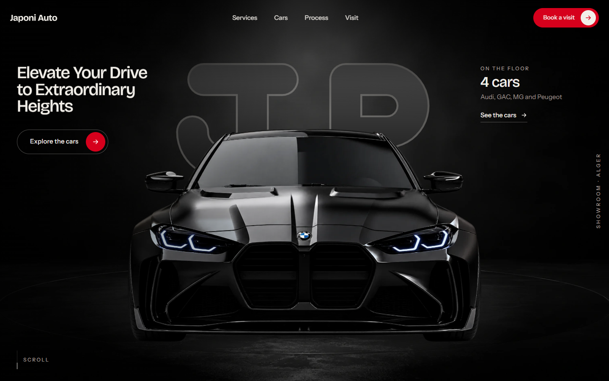
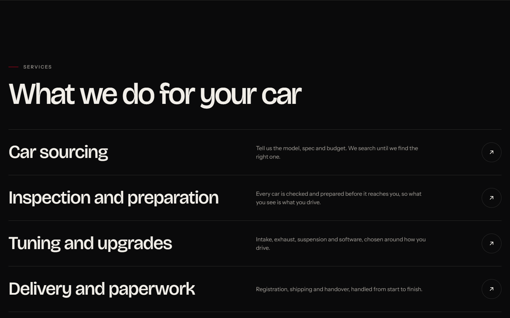
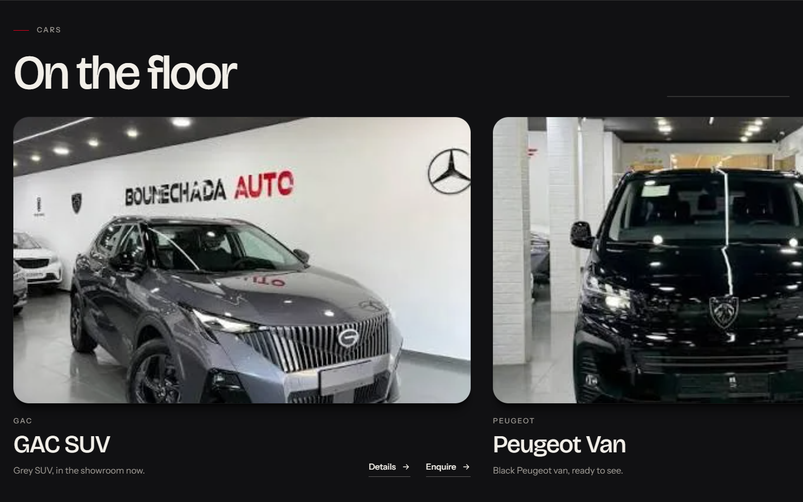
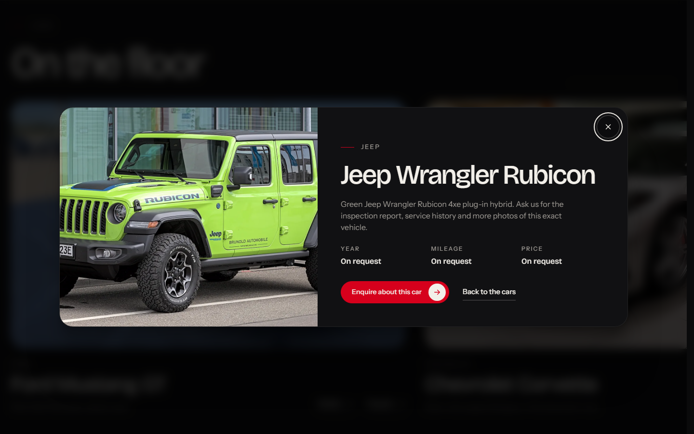
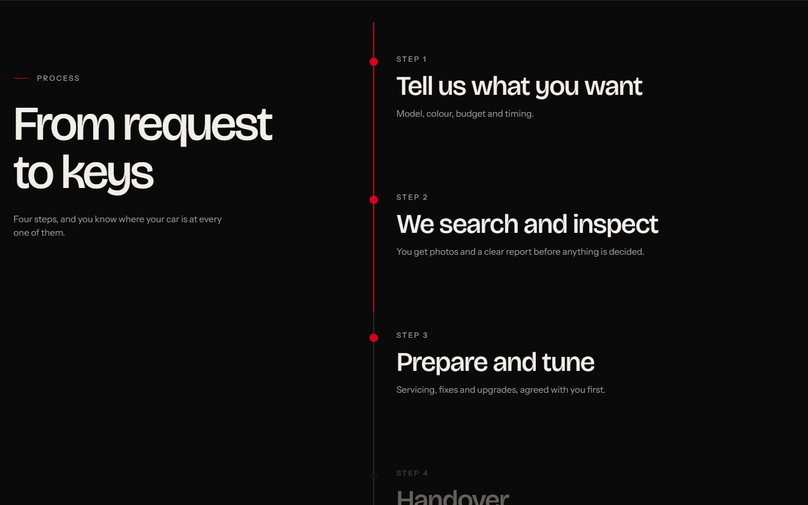
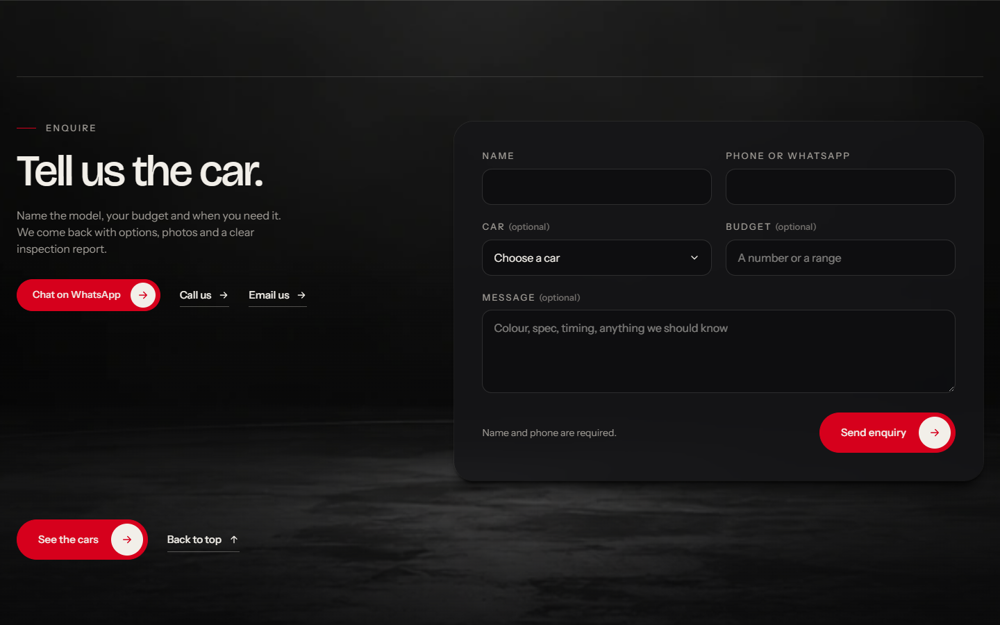
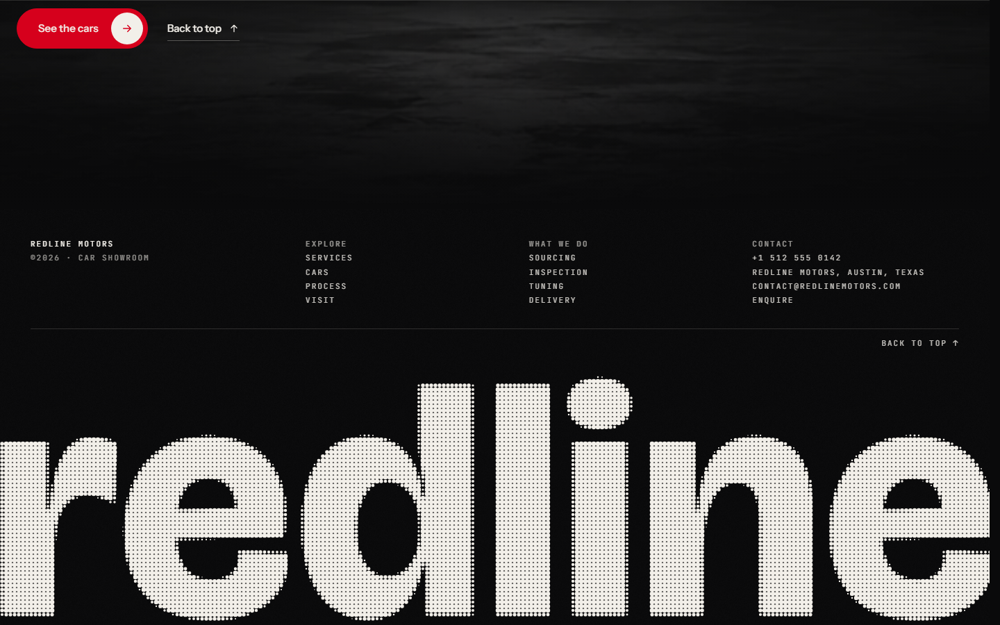
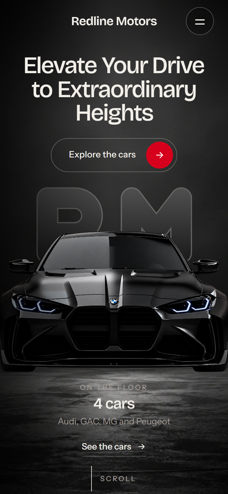
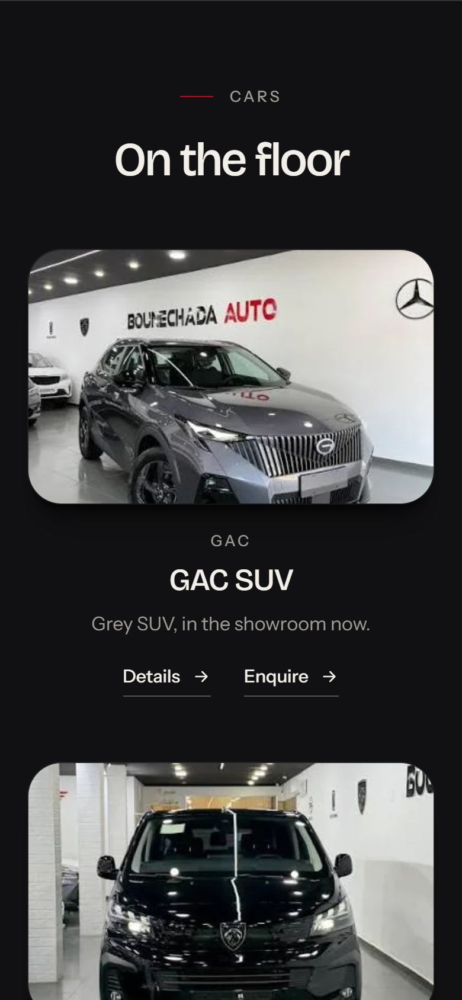
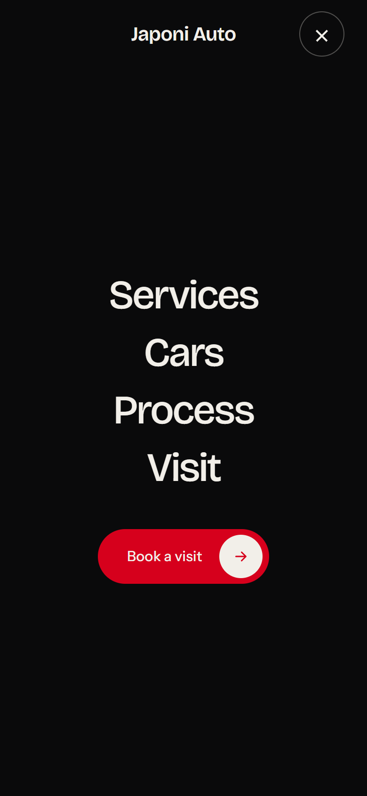

# Japoni Auto

A one-page website for **Japoni Auto**, a car showroom in Algiers. It's a dark, motion-led site that walks visitors from the hero car to the cars on the floor and finishes with an enquiry they can send on WhatsApp or by email.

Built with **React 19 + Vite**, animated with **GSAP / ScrollTrigger** and smooth-scrolled with **Lenis**.

**Live site:** https://japoni-auto-ten.vercel.app



## Screenshots

| | |
|---|---|
|  |  |
| **Services**: four rows that slide and fill on hover | **On the floor**: a pinned horizontal gallery on desktop |
|  |  |
| **Car details**: year, mileage, price and a direct enquiry | **Process**: a red rail fills as you scroll the four steps |
|  |  |
| **Enquiry**: validated form that writes up a ready-to-send message | **Footer**: a halftone wordmark whose dots spring away from the pointer |

<p align="center">
  
  &nbsp;
  
  &nbsp;
  
</p>

## Features

- **Splash and intro**: the JP mark draws itself, then the showroom "warms up". The headlights flicker while the hero image and fonts load, and the lights come up.
- **Smooth scrolling** with Lenis, plus scroll-driven reveals, a word-by-word lit statement, a velocity-boosted marquee and parallax.
- **Car gallery**: pinned horizontal scroll on screens 1024px and wider, a stacked list below that. Click a card for its details.
- **Enquiry flow**: picking "Enquire" on any car pre-selects it in the form. On submit the visitor gets the message written up, with buttons to send it on WhatsApp or by email, or to copy it. Nothing is sent to a server.
- **Pointer details** (mouse only): magnetic buttons, a ring cursor, and hero depth that drifts the car against the mark.
- **Accessible**: reduced-motion support turns all motion off, the menu and dialog trap and restore focus and close on <kbd>Esc</kbd>, and split-word headings keep readable labels.
- **Responsive** from 320px phones to wide desktops.

## Getting started

Requires Node.js 20.19+.

```bash
npm install
npm run dev       # start the dev server at http://localhost:5173
npm run build     # production build into dist/
npm run preview   # serve the production build locally
```

The build uses a relative base (`./`), so `dist/` can be hosted from any folder, including GitHub Pages.

## Deployment

The site is hosted on Vercel and connected to this repository: every push to `main` deploys to production, and other branches get preview deployments.

## Editing content

| What | Where |
|---|---|
| Phone, WhatsApp, email, address, opening hours, map link | [`src/data/site.js`](src/data/site.js) |
| Cars on the floor (name, brand, photo, blurb, year/mileage/price, specs) | [`src/data/cars.js`](src/data/cars.js) |
| Colours, fonts and layout | [`src/styles.css`](src/styles.css) (design tokens at the top under `:root`) |
| Images | [`src/assets/img/`](src/assets/img) |

**Adding a car:** drop the photo in `src/assets/img/`, import it at the top of `src/data/cars.js` and add an entry to `CARS`. The hero count, brand list, gallery and enquiry dropdown all update by themselves. Any field left empty in `site.js` falls back to a neutral line, and its button stays hidden.

## Project structure

```
src/
├── App.jsx              page layout, menu / dialog / enquiry state
├── main.jsx             entry point
├── styles.css           all styles
├── components/
│   ├── Splash.jsx       first-screen mark animation
│   ├── Nav.jsx          header and mobile menu
│   ├── Hero.jsx         hero stage and loader
│   ├── Sections.jsx     marquee, statement, services, process
│   ├── Cars.jsx         car gallery and cards
│   ├── CarDialog.jsx    car details dialog
│   ├── Visit.jsx        contact details and enquiry form
│   ├── Footer.jsx       footer with the halftone canvas wordmark
│   └── ui.jsx           buttons, links, icons, split-word text
├── data/
│   ├── site.js          showroom contact details
│   └── cars.js          cars on the floor
└── lib/
    ├── motion.js        motion flags and shared scroll helpers
    └── useMotion.js     GSAP / ScrollTrigger / Lenis setup
```
